# Resources

This repo is to reproduce the tutorial:
[TUTORIAL: How to Build an Open Lakehouse on Your Laptop](https://systemsnull.net/posts/data-engineering-ai/open-lakehouse-on-your-laptop)

But I add an extra section for putting Trino and its catalogs for query engine.

## Basic Requirements

- Memory and disk. The whole stack uses about **9 GB of RAM** once everything is up, so a 16 GB machine is comfortable; in Docker Desktop, raise the memory limit under `Settings > Resources` to at least 10 GB. Plan for about 12 GB of disk for images and downloads.
- Docker (with compose)
- Python (venv or conda)
- Rustc/Cargo + Bun (for Unity Catalog UI)

```bash
> conda create -n local-lakehouse python=3.14
> conda activate local-lakehouse
> pip install pyspark-client==4.2.0 pandas==2.3.3 boto3==1.43.93 kafka-python==2.3.0 pyiceberg==0.12.0 duckdb==1.5.6 mlflow-skinny==3.16.1
```

# Storage: SeaweedFS

## We create first a bucket for our lakehouse
```bash
·> python 01_create_lakehouse_bucket.py
hello.txt 17 bytes
```

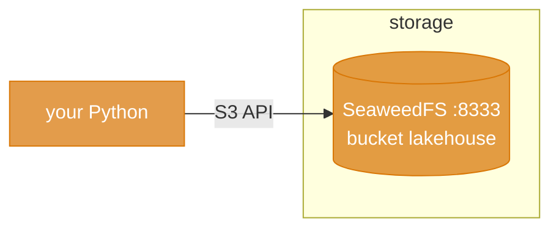

# Compute: Spark 4.2 and Spark Connect

Our lakehouse use Spark as compting engine which can read/write data to Seaweedfs

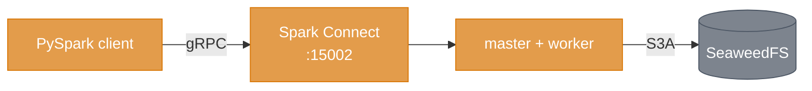


> We test a dummy Spark job
```bash
·> python 02_hello_spark.py
Connected to Spark 4.2.0 at sc://localhost:15002
+------------+
|       total|
+------------+
|499999500000|
+------------+
```


# Some data: a ghost-kitchen generator

This is a script to generate some data logs, writing to landing storage

```bash
·> python 03_generate_orders.py files
landing/orders/2026-09-01.parquet  4,720 rows
landing/orders/2026-09-02.parquet  4,382 rows
landing/orders/2026-09-03.parquet  5,479 rows
landing/orders/2026-09-04.parquet  4,508 rows
landing/orders/2026-09-05.parquet  5,194 rows
landing/orders/2026-09-06.parquet  4,962 rows
landing/orders/2026-09-07.parquet  4,776 rows
landing/locations/locations.parquet  4 rows
```

# Table format: Delta Lake
Now, we use spark to read data from landing storage and write into a delta table at location `TABLE_PATH = "s3://lakehouse/tables/orders_raw"`

```bash
·> python 04_load_orders.py
+-------+---------+-------------+
|version|operation|numOutputRows|
+-------+---------+-------------+
|      1|    WRITE|        29301|
|      0|    WRITE|         4720|
+-------+---------+-------------+

rows now: 34,021   rows at version 0: 4,720

tables/orders_raw/_delta_log/00000000000000000000.crc
tables/orders_raw/_delta_log/00000000000000000000.json
tables/orders_raw/_delta_log/00000000000000000001.crc
tables/orders_raw/_delta_log/00000000000000000001.json
tables/orders_raw/_delta_log/_staged_commits/
tables/orders_raw/part-00000-493168f5-9d04-4ce9-9dad-ee5a503af74f-c000.snappy.parquet
tables/orders_raw/part-00000-5ac9333a-1868-493b-8d9a-63c127d2995f-c000.snappy.parquet
tables/orders_raw/part-00001-6b619c3f-8a33-46d1-ae55-5d8e3a5882bf-c000.snappy.parquet
tables/orders_raw/part-00001-db641e30-998d-4c19-bbfa-dece791034ae-c000.snappy.parquet
```

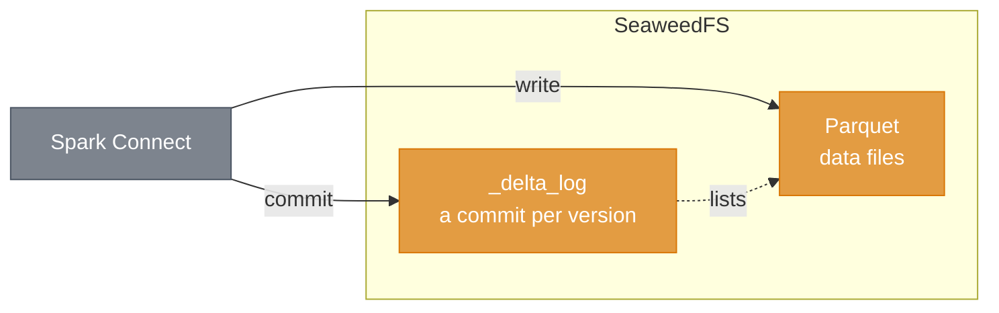

# Catalog: Unity Catalog OSS

The delta table exist now in S3 storage, we can query it with delta location, but we can register it into Unity Catalog to ease the management.

The following script will
- create a catalog `lakehouse` at `s3://lakehouse/managed`
- create a schema `lakehouse.tutorial`
- register the delta table created in S3 bucket above as `lakehouse.tutorial.orders_raw`

```bash
·> python 05_register_orders.py
+----------+------+
|event_date|events|
+----------+------+
|2026-09-01|  4720|
|2026-09-02|  4382|
|2026-09-03|  5479|
|2026-09-04|  4508|
|2026-09-05|  5194|
|2026-09-06|  4962|
|2026-09-07|  4776|
+----------+------+

orders_raw EXTERNAL DELTA s3://lakehouse/tables/orders_raw
```

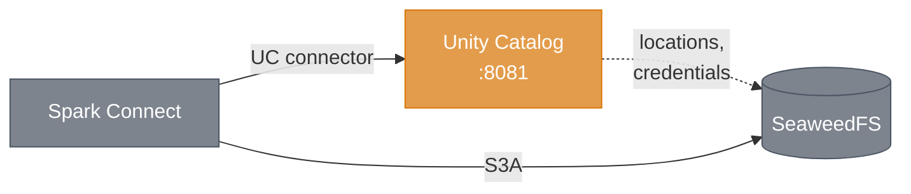

# Open formats: read the same table as Iceberg

We can enable Iceberg metadata for the same Delta table with Uniform
```bash
·> python 06_enable_uniform.py
tables/orders_raw/metadata/00000-2a00378b-76c7-4058-96b5-b49d05e2520a.metadata.json
tables/orders_raw/metadata/f2ff3caa-d926-4d7a-a33e-4cc8ef48d5b8-m0.avro
tables/orders_raw/metadata/snap-7000200278295571351-1-f2ff3caa-d926-4d7a-a33e-4cc8ef48d5b8.avro
```

Then we can read as Iceberg clients
```bash
·> python 07_read_iceberg.py
Reading s3://lakehouse/tables/orders_raw/metadata/00000-2a00378b-76c7-4058-96b5-b49d05e2520a.metadata.json

PyIceberg: 34,021 rows (Iceberg v2, converted from Delta version 2)

┌────────────┬────────┐
│ event_date │ events │
│    date    │ int64  │
├────────────┼────────┤
│ 2026-09-01 │   4720 │
│ 2026-09-02 │   4382 │
│ 2026-09-03 │   5479 │
│ 2026-09-04 │   4508 │
│ 2026-09-05 │   5194 │
│ 2026-09-06 │   4962 │
│ 2026-09-07 │   4776 │
└────────────┴────────┘
```

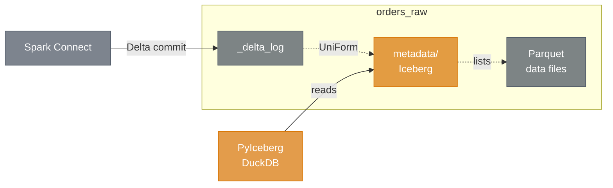

# Pipelines: bronze, silver, gold with Spark Declarative Pipelines

> Spark Declarative Pipelines (SDP) lets you declare each table as a query; SDP works out the dependency graph from the tables each query reads and materializes them in order. 

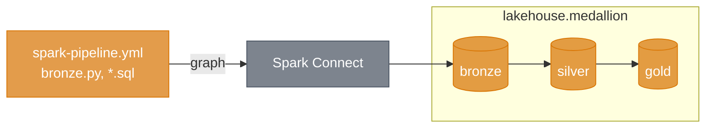

```bash
·> ./08_run_pipeline.sh
lakehouse.medallion is ready
2026-11-15 21:24:42: Loading pipeline spec from pipeline/spark-pipeline.yml...
2026-11-15 21:24:42: Creating Spark session...
2026-11-15 21:24:42: Creating dataflow graph...
2026-11-15 21:24:42: Registering graph elements...
...
2026-11-15 21:24:50: Starting run...
2026-11-15 14:25:04: Flow lakehouse.medallion.locations is QUEUED.
2026-11-15 14:25:04: Flow lakehouse.medallion.orders_silver is QUEUED.
2026-11-15 14:25:04: Flow lakehouse.medallion.revenue_by_brand is QUEUED.
2026-11-15 14:25:04: Flow lakehouse.medallion.revenue_by_city_day is QUEUED.
2026-11-15 14:25:04: Flow lakehouse.medallion.orders_bronze is QUEUED.
2026-11-15 14:25:04: Flow lakehouse.medallion.orders_bronze is PLANNING.
2026-11-15 14:25:04: Flow lakehouse.medallion.orders_bronze is STARTING.
2026-11-15 14:25:04: Flow lakehouse.medallion.orders_bronze is RUNNING.
2026-11-15 14:25:04: Flow lakehouse.medallion.locations is PLANNING.
2026-11-15 14:25:04: Flow lakehouse.medallion.locations is STARTING.
2026-11-15 14:25:04: Flow lakehouse.medallion.locations is RUNNING.
2026-11-15 14:25:09: Flow lakehouse.medallion.orders_bronze has COMPLETED.
2026-11-15 14:25:09: Flow lakehouse.medallion.locations has COMPLETED.
2026-11-15 14:25:09: Flow lakehouse.medallion.orders_silver is PLANNING.
2026-11-15 14:25:09: Flow lakehouse.medallion.orders_silver is STARTING.
2026-11-15 14:25:09: Flow lakehouse.medallion.orders_silver is RUNNING.
2026-11-15 14:25:16: Flow lakehouse.medallion.orders_silver has COMPLETED.
2026-11-15 14:25:17: Flow lakehouse.medallion.revenue_by_city_day is PLANNING.
2026-11-15 14:25:17: Flow lakehouse.medallion.revenue_by_city_day is STARTING.
2026-11-15 14:25:17: Flow lakehouse.medallion.revenue_by_city_day is RUNNING.
2026-11-15 14:25:17: Flow lakehouse.medallion.revenue_by_brand is PLANNING.
2026-11-15 14:25:17: Flow lakehouse.medallion.revenue_by_brand is STARTING.
2026-11-15 14:25:17: Flow lakehouse.medallion.revenue_by_brand is RUNNING.
2026-11-15 14:25:21: Flow lakehouse.medallion.revenue_by_city_day has COMPLETED.
2026-11-15 14:25:21: Flow lakehouse.medallion.revenue_by_brand has COMPLETED.
2026-11-15 14:25:23: Run is COMPLETED.
```

The run produce data in bronze, silver, gold tables. We can see as bellow that the bronze table is created identical to the delta table we created above from landing data.

```bash
·> python 09_read_gold.py
=========== BRONZE TABLES ==========
+----------+------+
|event_date|events|
+----------+------+
|2026-09-01|  4720|
|2026-09-02|  4382|
|2026-09-03|  5479|
|2026-09-04|  4508|
|2026-09-05|  5194|
|2026-09-06|  4962|
|2026-09-07|  4776|
+----------+------+

+----------+------+
|event_date|events|
+----------+------+
|2026-09-01|  4720|
|2026-09-02|  4382|
|2026-09-03|  5479|
|2026-09-04|  4508|
|2026-09-05|  5194|
|2026-09-06|  4962|
|2026-09-07|  4776|
+----------+------+

=========== GOLD TABLES ==========
+-------------+------+---------+---------+
|        brand|orders|  revenue|avg_order|
+-------------+------+---------+---------+
|Sushi Express|  2140|160332.61|    74.92|
|  Curry House|  2219|133432.76|    60.13|
| Wok This Way|  2152|118668.13|    55.14|
| Pizza Planet|  2233| 93402.24|    41.83|
|    Taco Loco|  2168| 71548.53|     33.0|
+-------------+------+---------+---------+

locations MANAGED DELTA s3://lakehouse/managed/__unitystorage/catalogs/ca354fda-466e-4e8f-bd08-8abc26629c21/tables/3d71f6a6-6177-4acf-bf43-91b666f27c50
orders_bronze MANAGED DELTA s3://lakehouse/managed/__unitystorage/catalogs/ca354fda-466e-4e8f-bd08-8abc26629c21/tables/f1d85cd3-ca69-41fe-a803-c494b3c2e535
orders_silver MANAGED DELTA s3://lakehouse/managed/__unitystorage/catalogs/ca354fda-466e-4e8f-bd08-8abc26629c21/tables/117a82ed-a1fc-41dc-9e73-0e130117c500
revenue_by_brand MANAGED DELTA s3://lakehouse/managed/__unitystorage/catalogs/ca354fda-466e-4e8f-bd08-8abc26629c21/tables/203a9d4b-1711-4e81-a6e1-8ec1a9eb766c
revenue_by_city_day MANAGED DELTA s3://lakehouse/managed/__unitystorage/catalogs/ca354fda-466e-4e8f-bd08-8abc26629c21/tables/52d7fea9-bb6e-41ca-b85c-93fc08fe5a60
```

# Streaming: Real-Time Mode and micro-batches

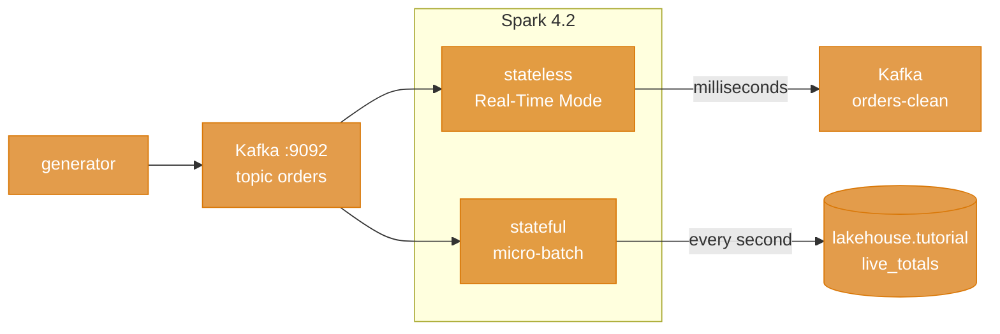

## Create Kafka topics

```bash
> docker compose exec kafka /opt/kafka/bin/kafka-topics.sh --bootstrap-server kafka:9092 --create --topic orders --partitions 2
Created topic orders.
> docker compose exec kafka /opt/kafka/bin/kafka-topics.sh --bootstrap-server kafka:9092 --create --topic orders-clean --partitions 2
Created topic orders-clean.
```

## Create checkpoint bucket in S3 for streaming job

```bash
·> python script_s3_create_bucket.py checkpoints
```

## Launch the Kafka consumers
```bash
·> python 10_stream_clean.py
orders -> orders-clean, in Real-Time Mode. Ctrl+C to stop.
```

```bash
·> python 10_stream_totals.py
orders -> lakehouse.tutorial.live_totals, every second. Ctrl+C to stop.
```

## Launch the Producer for generating orders
```bash
·> python 03_generate_orders.py stream
sent 1,000 events
sent 2,000 events
sent 3,000 events
sent 3,746 events to the topic orders
```

## Checking
We can check the message produced in Kafka topic `orders-clean`
```bash
·> docker compose exec kafka /opt/kafka/bin/kafka-console-consumer.sh --bootstrap-server kafka:9092 --topic orders-clean --from-beginning --max-messages 3
{"event_id":"7b8cfc6245-0","location_id":3,"brand":"Curry House","total":83.14,"received_ms":1794406647325}
{"event_id":"f6e09507cf-0","location_id":1,"brand":"Taco Loco","total":42.44,"received_ms":1794406647392}
{"event_id":"50e87c4f9f-0","location_id":3,"brand":"Pizza Planet","total":14.63,"received_ms":1794406647443}
Processed a total of 3 messages
```

And we can check the checkpoint folders in S3

```bash
·> python script_s3_list_objects.py checkpoints orders_clean | wc -l
     221
·> python script_s3_list_objects.py checkpoints live_totals | wc -l
     221
```

And compare with messages produced in delta table

```bash
·> python 11_check_stream.py
+-----------+------+--------+-----------------------+
|location_id|orders|revenue |last_order_at          |
+-----------+------+--------+-----------------------+
|1          |271   |13893.38|2026-11-18 15:55:01.759|
|2          |336   |17073.44|2026-11-18 15:55:01.875|
|3          |313   |16325.25|2026-11-18 15:55:01.709|
|4          |286   |14751.55|2026-11-18 15:55:01.803|
+-----------+------+--------+-----------------------+

order_created records sent:        1,243
distinct order_created event ids:  1,206
orders in live_totals:             1,206

orders-clean: 1,243 records, p50 1 ms, p99 104 ms in Spark
```

# Orchestration: Airflow runs the pipeline and the maintenance

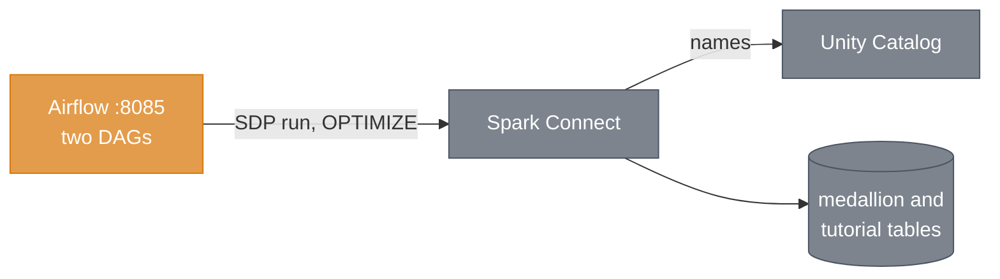

```bash
·> docker compose exec airflow airflow dags unpause medallion
dag_id    | is_paused
==========+==========
medallion | True

·> docker compose exec airflow airflow dags unpause delta_maintenance
dag_id            | is_paused
==================+==========
delta_maintenance | True
```

```bash
·> docker compose exec airflow airflow dags list-runs medallion -o plain
dag_id     run_id                                    state    run_after                         logical_date               start_date                        end_date
medallion  manual__2026-11-11T15:26:49.565888+00:00  success  2026-11-11T15:26:49.565888+00:00  2026-11-11T15:26:45+00:00  2026-11-11T15:26:51.007140+00:00  2026-11-11T15:36:04.505733+00:00

·> docker compose exec airflow airflow dags list-runs delta_maintenance -o plain
dag_id             run_id                                    state    run_after                         logical_date               start_date                        end_date
delta_maintenance  manual__2026-11-11T15:36:45.350134+00:00  success  2026-11-11T15:36:45.350134+00:00  2026-11-11T15:36:43+00:00  2026-11-11T15:36:46.861085+00:00  2026-11-11T15:37:29.911793+00:00

·> docker compose exec airflow grep -rhoE "revenue_by_brand has [0-9]+ rows|lakehouse[.a-z_]+: [0-9]+ files -> [0-9]+" /opt/airflow/logs
revenue_by_brand has 5 rows
lakehouse.tutorial.orders_raw: 1 files -> 1
lakehouse.tutorial.live_totals: 1 files -> 1
lakehouse.tutorial.orders_raw: 3 files -> 1
```

```bash
·> python read_iceberg.py
Reading s3://lakehouse/tables/orders_raw/metadata/00000-15792122-a75a-430d-a354-123409a50c06.metadata.json

PyIceberg: 34,021 rows (Iceberg v2, converted from Delta version 3)

┌────────────┬────────┐
│ event_date │ events │
│    date    │ int64  │
├────────────┼────────┤
│ 2026-09-01 │   4720 │
│ 2026-09-02 │   4382 │
│ 2026-09-03 │   5479 │
│ 2026-09-04 │   4508 │
│ 2026-09-05 │   5194 │
│ 2026-09-06 │   4962 │
│ 2026-09-07 │   4776 │
└────────────┴────────┘
```

# ML: MLflow tracks what you compute

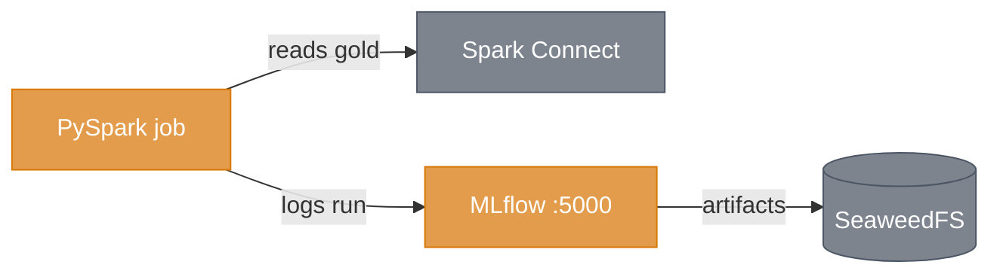

```bash
·> python log_run.py
2026/11/11 22:41:51 INFO mlflow.tracking.fluent: Experiment with name 'ghost-kitchen' does not exist. Creating a new experiment.
I1111 22:41:51.591965 5983474 ev_poll_posix.cc:588] FD from fork parent still in poll list: fd(7, generation: 1)
I1111 22:41:51.603270 5983499 ev_poll_posix.cc:588] FD from fork parent still in poll list: fd(7, generation: 1)
I1111 22:41:51.615488 5983528 ev_poll_posix.cc:588] FD from fork parent still in poll list: fd(7, generation: 1)
🏃 View run brand-revenue at: http://localhost:5001/#/experiments/1/runs/28f9824e6c294a7e9ffa33f6d39b2092
🧪 View experiment at: http://localhost:5001/#/experiments/1
brand-revenue: FINISHED
  best_avg_order = 74.92
  brands = 5.0
  revenue = 577384.27
mlflow/1/28f9824e6c294a7e9ffa33f6d39b2092/artifacts/revenue_by_brand.csv

·> python read_csv_s3.py lakehouse "mlflow/1/28f9824e6c294a7e9ffa33f6d39b2092/artifacts/revenue_by_brand.csv"
           brand  orders    revenue  avg_order
0    Curry House    2219  133432.76      60.13
1      Taco Loco    2168   71548.53      33.00
2   Pizza Planet    2233   93402.24      41.83
3   Wok This Way    2152  118668.13      55.14
4  Sushi Express    2140  160332.61      74.92
```

# UC UI

Checkout unitycatalog repo from github. Go to ui-new folder

```bash
> git clone https://github.com/unitycatalog/unitycatalog.git
> cd ui-new
```

## Server bridge

```
server $> UC_SERVER=http://localhost:8081 PORT=8082 cargo run
    Finished `dev` profile [unoptimized + debuginfo] target(s) in 0.21s
     Running `/Users/minh-dungdang/Projects/aws-certificates/lakehouses-bigdata/unitycatalog/ui-new/server/target/debug/uc-ui-bridge`
2026-11-11T16:40:57.481513Z  INFO uc_ui_bridge: Unity Catalog UI bridge listening on 0.0.0.0:8082 uc_server=http://localhost:8081 auth_enabled=false

web $> bun install
bun install v1.4.4 (38afee6c8)
  🔍 Resolving...

web ·> VITE_API_TARGET=http://localhost:8082 bun run dev
```

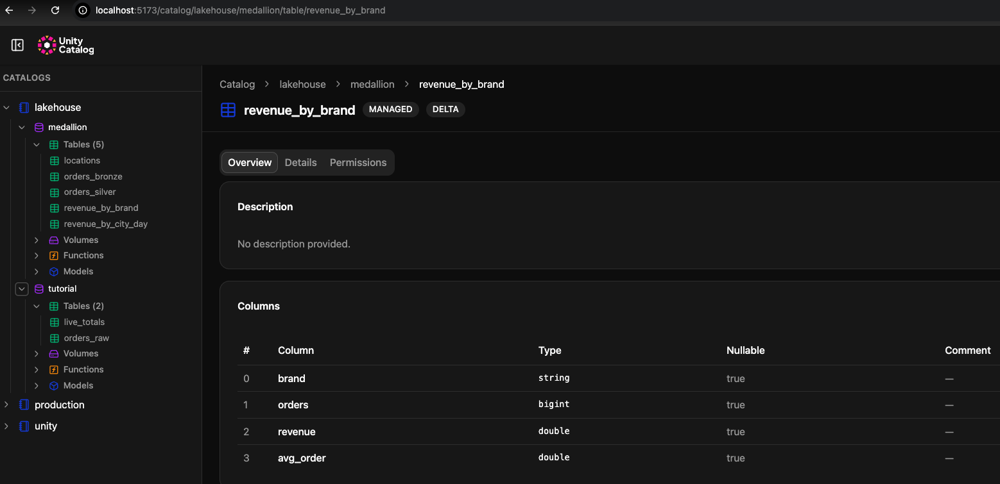


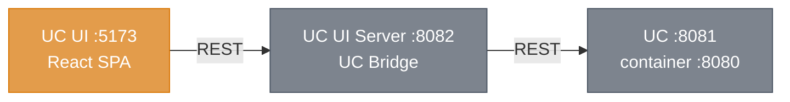

# Trino Set-Up

## Iceberg REST catalog

Seaweedfs supports a REST API for serving Iceberg catalog.
But we need a Table S3 bucket, not a ordinary S3 bucket

```sh
> docker compose exec seaweedfs weed shell
> s3tables.bucket -create -name iceberg-data -account 000000000000 -format ICEBERG
```

# Profiles

We can launch docker compose services with profiles, for example for seaweedfs storage only:
```bash
> docker compose --profile storage up -d --wait
```
and stop it

```bash
> docker compose --profile storage down
```

We can stop all profiles

```bash
·> docker compose --profile "*" down
```